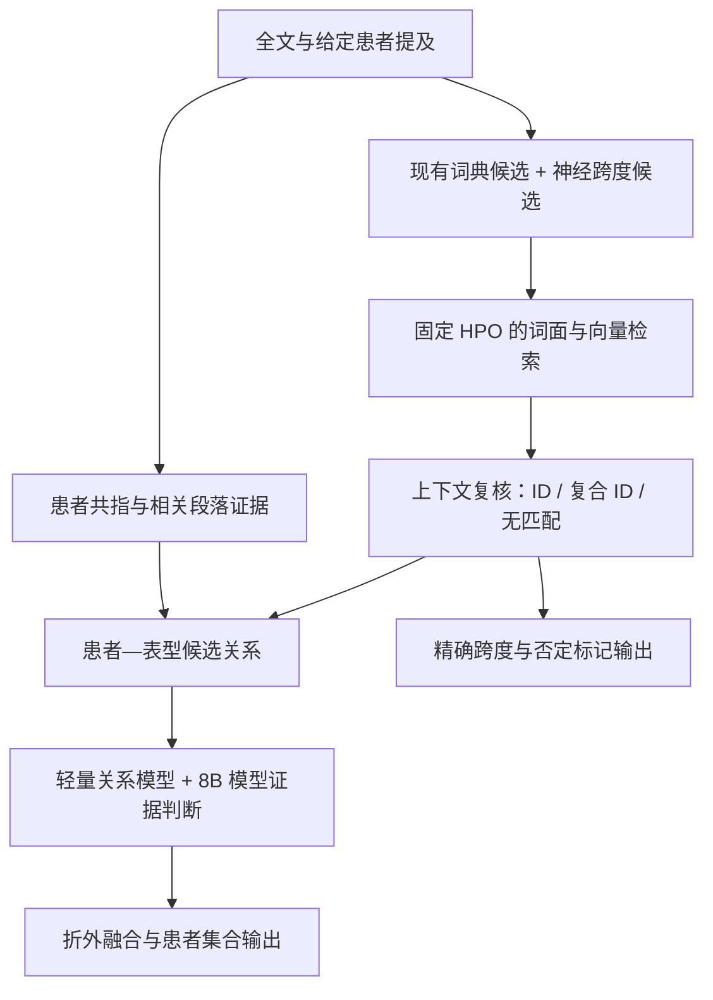

# PatientPheX 前沿方法调研

调研截止：2026-10-22。范围为生物医学全文中的表型提及识别、HPO 归一化、特定患者归属。
本报告区分文献结果、本地观察与建议实验；建议尚未执行。
优先查阅论文原文、组织方材料和作者仓库；不把不同数据集上的 F1 排成统一榜单。

最值得优先发展的路线是：**多源原文跨度候选 → 本体语义检索与上下文消歧 → 有证据的患者归属 → 折外融合**。
它同时得到同赛题方案与近期表型研究的支持，也对应当前系统的漏检和多患者混淆问题。

## 1. 与本题最直接的新证据

主办方于 **2026-10-21** 发布评测综述预印本。正式 B 榜第一名 Agriv 采用多源实体候选、
SapBERT 检索、LightGBM 排序、BioLinkBERT 复核，以及 8B 模型参与的患者归属融合；使用五折折外预测。
第二名结合多模型投票与 Qwen3.5-9B 校验，第三名结合跨度模型、检索及否定纠错。
这是同任务的直接证据，优先级高于单患者病历实验。见[组织方综述，第 4 节](https://arxiv.org/pdf/2610.29606)。

| B 集指标，百分制 | 当前本地系统的官方赛后成绩 | 论文中的组织方基线 | 论文中的正式 B 榜第一名 |
| --- | ---: | ---: | ---: |
| Mention F1 | 68.1782 | 72.11 | 77.19 |
| Document F1 | 75.6646 | 79.33 | 82.86 |
| 患者 Micro F1 | 56.9109 | 58.74 | 70.55 |
| 患者 Macro F1 | 49.5920 | 51.88 | 64.96 |
| 总分 | 62.5864 | 65.52 | 73.89 |

论文数据来自[表 3](https://arxiv.org/pdf/2610.29606)；我们的数据来自
[已保存的提交报告](RECALL_OPTIMIZATION_REPORT.md#官方评测状态)。按论文四舍五入值计算，
目前总分距该基线约 2.93 点，距第一名约 11.30 点。正式赛期与赛后成绩不是同一次复现实验；
这些差值用于定位差距，不代表采用其组件就能获得相同提升，也不是当前实时排名。

Agriv 的[权重仓库](https://huggingface.co/rigidk/CHIP2026-PatientPheX-Agriv)已公开，包含 NER、
交叉编码器、Qwen3-8B LoRA 和 LightGBM 权重。作者声明自训标签仅来自官方 80 篇。
只读 API 核实其创建于 2026-10-03，revision 为
`7a98ca95683eb920b09cc9141cdf512dc5f1fa41`；本次没有下载权重。
模型卡引用了评测材料包中的推理代码，但本次没有找到可公开核验的完整代码包，不能称已具备一键复现条件。

**这些全量权重已经用过我们 64/16 划分中的 16 篇文献。** 直接载入后在这 16 篇上打分会造成训练泄漏。
方法比较必须在自己的分组划分内重新拟合；作者的折模型也须先核对折成员才能用于折外评估。

## 2. 值得关注的近期方法

### AutoPCR：多来源候选、并列表达拆解和本体难例学习

**Bioinformatics，2026-07-07；预印本始于 2025-07-25。** 结合 BioNER 与句法候选，拆解并列表达，
用 SapBERT 检索，再按置信度决定是否交给 LLM 消歧；额外构造本体难正例、难负例做自监督训练。
两项迁移限制尤其重要：论文 mention 指标接受边界重叠，本题要求精确边界；正式论文的主生成后端为
80B MoE、微调基座为 30B MoE，即使激活参数只有 3B，也不能按本题 10B 上限直接使用。
见[论文](https://academic.oup.com/bioinformatics/article/42/Supplement_1/btag304/8726349)、
[作者代码](https://github.com/yctao7/AutoPCR)。

对我们最有价值的是候选构造和难例训练思路。实现时，拆解后的检索短语与最终提交的原文跨度必须分别保存，
不能把拼接生成的短语伪装成原文中的连续实体。论文使用的外部标注语料与调参划分也不能直接迁入本赛题。

### LEAP：把自由文本理解与 HPO 编号选择分开

**Journal of Genetics and Genomics，2026-02-14 在线发表。** LLM 先提取表型描述，
句向量模型再完成本体映射。训练的 5,330,557 对来自 HPO、MeSH 和 UMLS 名称、定义及同义词，
不能将这个规模误读成数百万份人工标注病历。见[论文记录](https://pubmed.ncbi.nlm.nih.gov/41698530/)、
[出版方方法说明](https://www.sciencedirect.com/science/article/abs/pii/S1673852726000536)。

[作者实现](https://github.com/Marker0707/LEAP)支持本地模型、嵌入检索和可选交叉编码器复排。
其默认可删除祖先节点以保留更具体概念，这是诊断画像的设计选择；本题若分别标注了两个概念，
照搬会损失召回。固定本题 HPO 版本、保留原文证据、重新验证取舍策略后再使用。
代码可读不等于论文中的全部权重和实验已完成本地复现。

### RAG-HPO：候选本体约束能减少无效 ID，仍会选错相近节点

**Genome Medicine，2025-08-18。** 在 112 个病例报告组成的评估集上，最佳 Llama-3.1-70B
配置报告 F1 0.78。它先提取表型，再检索本体候选让模型选择。
其 315 个假阳性中，70 个是祖先节点、230 个是其他相关节点；有效 HPO ID 仍可能语义不够精确。
见[论文](https://link.springer.com/article/10.1186/s13073-025-01521-w)、
[代码](https://github.com/PoseyPod/RAG-HPO)。

我们应增加上下文复核与“候选均不适合”的出口，不能强制每个片段匹配一个 ID。
该论文排除了少于四个表型的病例，且最优后端超过参数上限，不能据此推断本题少表型患者的 Macro 收益。

### RARE-PHENIX：抽取、归一化与表型重要性排序的完整流程

**npj Digital Medicine，2026-10-15，已接收论文的提前公开版本；预印本为 2026-02-23。**
流程包括 LLM 抽取、HPO 归一化和监督排序；外部验证为 143 位患者的 16,357 份病历。
见[期刊页面](https://www.nature.com/articles/s41746-026-03275-0)、
[方法预印本](https://arxiv.org/html/2602.20324v1)。

排序目标是挑出对罕见病诊断重要的表型，和本题尽量完整、准确地找出被标注表型的目标有差别。
公开的 [RareDis 适配器](https://huggingface.co/shyrcathy/rare-phenix-llama2-70b-raredis)
也不是完整 UDN 训练系统。其外部专家标注训练来源不能直接用于本赛题；优先借鉴模块化分析和错误归因。

### GLiM：文档图模型处理常规关系，LLM 处理困难关系

**Findings of ACL，2025-07。** 用图增强 Transformer 缩小关系候选范围，再调用 LLM 推断困难实体对。
这是跨句生物医学关系抽取的相邻领域证据，没有直接证明在 PatientPheX 上有效。
见[论文](https://aclanthology.org/2025.findings-acl.727/)、[代码](https://github.com/HaoFang10/GLiM)。

可迁移的方向是把患者提及、表型提及和段落组织成证据图，并将推理算力集中在跨段、共指及模型分歧上。
不应把论文对“不完整标注”的处理假设直接套用到本题，更不能将自行补出的关系当成官方金标准。

### GLiNER2：小型抽取模型作为补充候选来源

**EMNLP 2025 System Demonstrations。** 采用统一 schema 做实体、分类和结构化抽取，论文模型约 205M，
适合将小编码器纳入成本较低的候选管线。训练混合真实文本与合成文本，并使用自动标注。
其原始实验没有验证本题的 HPO 归一化和多患者归属，层次结构抽取也缺少对应零样本基准评估。
见[论文](https://aclanthology.org/2025.emnlp-demos.10/)、
[方法细节](https://arxiv.org/html/2507.18546v1)、[代码](https://github.com/fastino-ai/GLiNER2)。

对我们而言，它是小模型候选来源之一，不能预先认定胜过用官方训练集微调的生物医学编码器。
具体 checkpoint 的训练来源仍需逐个核对。

### 两项可跟踪、暂不作为主线的工作

| 工作 | 值得借鉴 | 当前证据或迁移限制 |
| --- | --- | --- |
| [HPO + MCP，2026-05-25 预印本](https://pmc.ncbi.nlm.nih.gov/articles/PMC13232345/) | 用外部本体工具替代模型记忆编号 | 只有四份合成临床文本；重复两千余次运行不等于两千个独立病例。支持本体检索的价值，不能证明多智能体架构或全文泛化。 |
| [TimeX，2026-06-19](https://www.nature.com/articles/s44401-026-00099-8) | 模块化处理否定、叙述主体和局部证据 | 主要评价表型发病时间；单患者病历中删除家族史的规则不能用于本题多患者文献。 |

[PhenoGPT2 作者仓库](https://github.com/WGLab/PhenoGPT2)还提供以 8B 文本基座做领域适配、
附带否定及叙述主体校验的路线。仓库同时列出模型链接和联系作者获取权重的说明，
本次没有核实所有权重的实际可下载性，也没有据其 README 宣称已可完整复现。

## 3. 当前系统的瓶颈如何对应这些方向

以下是已有 16 篇本地开发文献的观察，不是本次新增实验。来源：
[结果报告](RECALL_OPTIMIZATION_REPORT.md)；机器错误分析位于服务器保留的
`runs/recall_optimization_v1/analysis.json`，未随源码上传。

| 已观察问题 | 证据 | 推导出的实验重点 |
| --- | --- | --- |
| 描述性表型没有候选 | 486 个 mention FN 中，313 个没有重叠候选 | 新增跨度模型/句法候选；仅换 linker 无法补齐缺失跨度 |
| 精确边界不足 | 125 个 mention FN 属于边界错误 | 独立统计精确跨度召回，检查修饰语和复合表达 |
| 实体漏检向患者任务传递 | 212 个患者 FN 中，164 个是概念未抽取，约 77.4% | 上游候选召回与归属模型配套验证 |
| 跨患者误归属 | 84 个患者 FP 的概念属于其他目标患者 | 患者共指、跨段证据、相邻患者难负例 |
| 稀疏集合未改善 | 1–3 个表型的 23 位患者 Macro 基本不变 | 独立衡量少表型患者 precision 与空集合判断 |

四位金标准为空的患者均来自一篇文献，不能当作四个独立的稳定规律。
先前交叉拟合/集合阈值实验未被训练内选择采用；本文献调研不改变那个结论。
新模型的折外特征应作为新的完整实验评估，不能借冠军方案倒推旧实验已经有效。

## 4. 建议的实现结构

下面是结合文献与本地错误分析提出的设计，不是某篇论文的已复现结果。

原文跨度始终是不可改写的锚点。若 LLM 提出额外表型，只接受能映射回原文的证据；
复合表达保留原始跨度和多个候选 ID。段落选取应覆盖病例描述、表格及指代上下文，记录截断情况。
给定患者列表是身份范围：允许同一表型属于多人，允许某位患者输出空集合，不能强制一对一归属。

本体检索固定为 `2026-06-23 / HP:0000118`。候选中加入名称、定义及关系信息做消歧，
但不把相近词、父节点或疾病知识推断出的“常见症状”自动当成患者已经出现的表型。
无法归一化的真实表型仍按本题无 ID 规则处理，不为减少解析失败强配一个 HPO 编号。

## 5. 建议执行顺序与验证设计

| 优先级 | 最小实验 | 主要观察量 | 如何隔离收益来源 |
| --- | --- | --- | --- |
| P1 | 官方训练集内拟合 BioLinkBERT/PubMedBERT 跨度模型，与当前候选合并；加入 SapBERT 检索及轻量上下文复核 | 候选精确跨度召回、HPO Recall@K、最终四项 F1 | 分别比较新增候选、检索、复核；先固定现有关系模型，再独立评估重拟合 |
| P2 | 8B 模型读取患者相关证据，对候选关系给出支持/否定/不确定及证据位置；作为额外关系特征 | 患者 Micro/Macro、跨患者 FP、空/稀疏集合表现、每文献成本 | 固定 P1 实体输出，比较局部窗口与跨段证据；解析失败单独计数 |
| P3 | HPO 相邻概念难例学习，另设并列表型、否定和主体切换挑战子集 | 相邻节点误链、复合表达边界、稀疏患者精度 | 分开做实体归一化与归属校验，避免同时改多项后无法归因 |

P1 可先用标注跨度做 retrieval-only 诊断，以区分检索与候选发现的问题；这种诊断是金标准输入的上界分析，
不能报告成端到端成绩。参数量与推理成本各自记录，不能把 MoE 激活参数或 LoRA 可训练参数当作完整模型参数量。

所有训练、阈值选择、合成例子和候选校准都保持文献分组隔离。
沿用已冻结的 64/16 分组，在 64 篇内做训练内选择；重复查看过的 16 篇及线上 B 分数只作为受限的外部反馈。
若构造本体自监督数据，仅使用固定本体和当前训练折，不混入外部人工表型标注或 A/B 金标准。
合成医学文本需要验证语义，不能假设生成标签必然正确。

判断是否采用仍以四指标均值与患者 Macro 的预定条件为准，同时报告逐文献差异和患者分组结果。
通过文献聚类的 bootstrap 可描述采样不确定性，不能消除多轮选型偏差。
完整部署冠军权重、重新训练或大规模 LoRA 应放在这些诊断之后；本报告不预估尚未测量的涨分幅度。

## 6. 阅读与复用时必须保留的边界

比赛规则仍是每个模型不超过 10B、固定本体、不得使用外部人工标注表型数据集，
见[主办方说明](https://github.com/DUTIR-BioNLP/PatientPheX)。
公开论文允许我们学习方法，但论文的训练数据、已微调权重和默认配置需分别核对。
不因论文报告较高的语义相似度、宽松边界 F1 或诊断 Top-K 命中率，就将其当作本题精确匹配提升。

本次只完成公开资料调研和本地历史结果核对，没有运行模型、启动训练或进行新提交。
访问时间、发布状态、公开资源与关键限制另存于
[sources.json](research/frontier_20261022/sources.json)。
